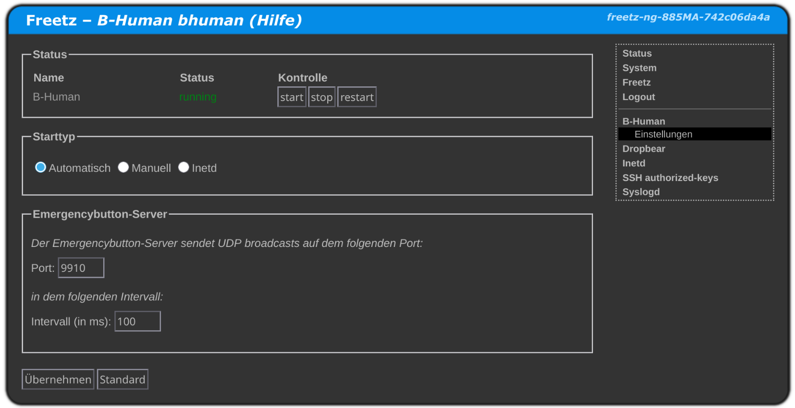

## About The Project

This repository contains everything needed to deploy the emergency button.

The emergency button has to be connected to any computer running the emergency\_button\_server software that shares the same network as the robots.
We're using the Fritz!Box to which each robot is connected to. This project will build a complete system image containing the server software.

The server expects the button to send a signal over the serial connection all the time, if interrupted the server will broadcast an "emergency" signal, otherwise it will send a "noemergency" signal. This message is be broadcasted on port 9910 over UDP.

It's subdivided into the following directories:
* EmergencyButtonEmbedded: Contains the software running on the button itself (An arduino pro micro)
* EmergencyButtonServer: The program running on the access point (MIPS architecture) receiving signals from the button and relaying it onto the Network using a UDP broadcast ping
* Schematic: Contains electrical diagrams and 3D models of the button 

> [!note]
> You will need a UNIX-like operating system in order to build this project


## Getting Started

With this project you are able to build the following files:

| File                    | Usage |
| ----------------------- | ----- |
| freetz-image.img        | Freetz-NG image used to flash onto a Fritz!Box 7580 |
| emergency\_button\_avr    | The program that will be flashed onto the button itself |
| emergency\_button\_server | The program running on the access point (Fritz!Box 7580) |
| emergency\_button\_client | A test client built for the hosts architecture used to receive UDP broadcast messages from the server |


### Prerequisites

You will be needing the following dependencies to be able to build this project:

* cmake
* gcc


### Building

1. Clone the repo
   The following will clone this repository into your current directory ($PWD)
   ```sh
   git clone --recurse-submodules --shallow-submodules git@gitlab.informatik.uni-bremen.de:B-Human/Utils/emergencybutton.git
   ```

2. Enter the cloned directory
   ```sh
   cd ./emergencybutton
   ```

2. Choose what you want to build
   You can specify which part of the project you want to build, adding no arguments will build all targets
   ```sh
   ./build.sh
   #./build.sh freetz
   #./build.sh server
   #./build.sh button
   #./build.sh all #(Same as ./build.sh)
   ```

   Running `build.sh` in the projects root directory is equivilant to running 
   the individual `build.sh` scripts in their respective directories and copying the output file into the `output` directory

### Deployment

   You can deploy the built binaries using the deploy script.
   The script will guide you in the deployment process.
   ```sh
   ./deploy.sh [freetz | button]
   ```

### Changing setting

   The default values for the server and button programs are stored in `./Config/config.sh`.
   The config file used by freetz' makefile is also stored in `./Config` called `freetz-ng.config`

   After flashing freetz, you can change the UDP port and broadcast interval inside freetz' webinterface under `http://[the routers address or FQDN]:81/cgi-bin/conf/bhuman`:
   {width=50%}
